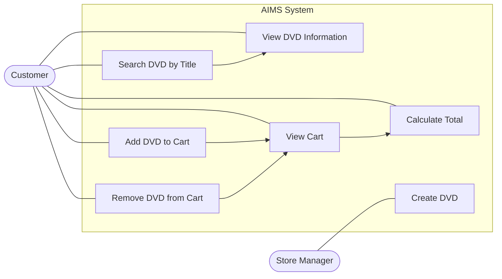

# Use Case Diagram – AIMS

## 1. Giới thiệu

AIMS (Advanced Integrated Media System) là hệ thống quản lý và bán các sản phẩm DVD. Hệ thống cho phép người dùng xem thông tin DVD, tìm kiếm sản phẩm và quản lý giỏ hàng.

Tài liệu này mô tả các tác nhân (Actors) và chức năng chính (Use Cases) của hệ thống.

## 2. Actors

| Actor | Mô tả |
|---|---|
| Customer | Người dùng tương tác với hệ thống để tìm kiếm DVD và quản lý giỏ hàng. |
| Store Manager | Người quản lý cửa hàng, có quyền tạo và quản lý thông tin DVD. |

## 3. Use Cases

| Use Case | Actor | Mô tả |
|---|---|---|
| Create DVD | Store Manager | Tạo DVD mới và thêm thông tin DVD vào hệ thống. |
| Search DVD by Title | Customer | Tìm kiếm DVD theo tên (title). |
| View DVD Information | Customer | Xem thông tin chi tiết của DVD. |
| Add DVD to Cart | Customer | Thêm DVD vào giỏ hàng. |
| Remove DVD from Cart | Customer | Xóa DVD khỏi giỏ hàng. |
| View Cart | Customer | Xem danh sách DVD hiện có trong giỏ hàng. |
| Calculate Total | Customer | Tính tổng giá trị các sản phẩm trong giỏ hàng. |

## 4. Use Case Diagram

## 5. Mối quan hệ giữa Actors và Use Cases

### Customer
- Có thể tìm kiếm DVD theo tên.
- Có thể xem thông tin chi tiết của DVD.
- Có thể thêm DVD vào giỏ hàng.
- Có thể xóa DVD khỏi giỏ hàng.
- Có thể xem giỏ hàng và tính tổng giá trị đơn hàng.

### Store Manager
- Có thể tạo DVD mới và cập nhật danh mục sản phẩm của hệ thống.

### Relationships
- Search DVD by Title giúp Customer tìm được DVD mong muốn.
- Add DVD to Cart và Remove DVD from Cart làm thay đổi nội dung giỏ hàng.
- View Cart cho phép Customer kiểm tra các DVD đã chọn.
- Calculate Total xác định tổng giá trị của giỏ hàng.

## 6. Kết luận

Use Case Diagram mô tả các chức năng chính của hệ thống AIMS và cách các actors tương tác với hệ thống. Qua đó, xác định được phạm vi chức năng phục vụ khách hàng và quản lý sản phẩm DVD.